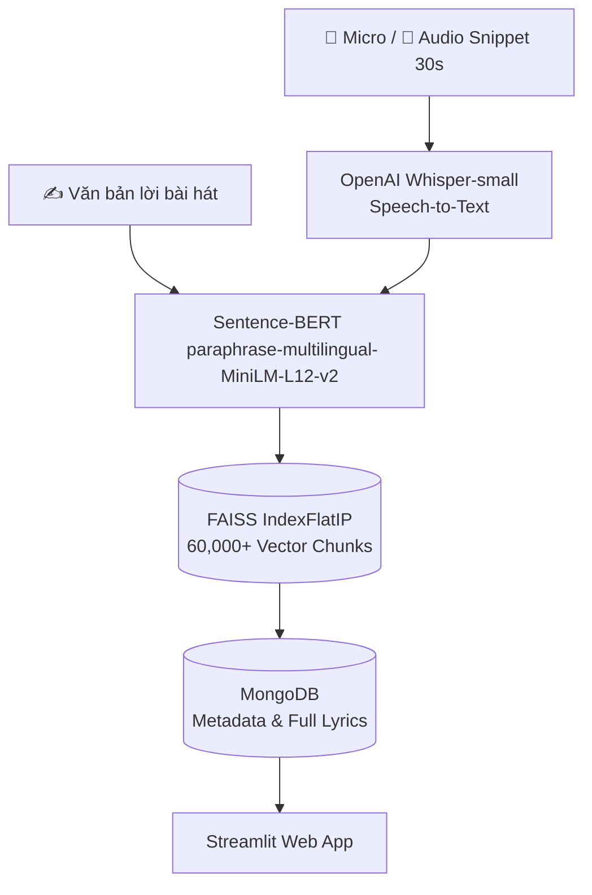

# 🎧 AI Music Matcher / LyricsSearch

> **Hệ thống nhận diện và tìm kiếm bài hát thông minh qua giọng hát, đoạn thu âm (Audio Snippet) và lời bài hát (Lyrics).**

Dự án ứng dụng mô hình học sâu kết hợp giữa **Xử lý tín hiệu âm thanh (ASR)** và **Tìm kiếm ngữ nghĩa (Semantic NLP Vector Search)**.

---

## 🌟 Tính năng chính

1. 🎤 **Nhận diện qua Micro**: Người dùng hát hoặc đọc một đoạn giai điệu trực tiếp trên giao diện web, mô hình **OpenAI Whisper** sẽ bóc tách văn bản tiếng Việt và tìm bài hát tương ứng.
2. 📁 **Tải lên tệp âm thanh**: Tải lên đoạn audio (WAV, MP3) dài ~30s (điệp khúc) để hệ thống nhận diện bài hát tự động.
3. ✍️ **Tìm kiếm qua lời nhạc**: Người dùng gõ một hoặc vài câu hát nhớ mang máng, hệ thống sử dụng **Sentence-BERT** và **FAISS** để tìm kiếm ngữ nghĩa với độ chính xác cao.
4. 🎶 **Xác thực kết quả**: Nghe trực tiếp đoạn nhạc gốc tương ứng trên máy và xem toàn bộ lời bài hát được highlight câu hát khớp.

---

## 🏗️ Kiến trúc & Công nghệ



- **Audio Speech-to-Text**: `openai/whisper-small` (chạy tối ưu trên GPU qua CUDA FP16).
- **Text Embedding**: `sentence-transformers/paraphrase-multilingual-MiniLM-L12-v2` (384 chiều, chuẩn hóa Cosine).
- **Vector Search Engine**: `FAISS` (IndexFlatIP) băm theo kỹ thuật Sliding Window (1 câu, 2 câu, 3 câu liên tiếp).
- **Cơ sở dữ liệu**: `MongoDB` lưu trữ metadata bài hát, lời đầy đủ, lời đồng bộ (.lrc), đường dẫn snippet và văn bản nhận diện.
- **Audio Processing**: `librosa`, `soundfile`, `ffmpeg`, `yt-dlp`.
- **Giao diện**: `Streamlit` + `audio-recorder-streamlit`.

---

## 🚀 Hướng dẫn cài đặt & Khởi chạy

### 1. Khởi chạy MongoDB (Docker)
```bash
docker run -d --name lyrics_mongo -p 27017:27017 -v mongo_lyrics_data:/data/db --restart unless-stopped mongo:7.0
```

### 2. Nạp dữ liệu vào MongoDB
```bash
./venv/bin/python import_mongo.py
```

### 3. Khởi chạy ứng dụng Web (Streamlit)
```bash
./run_web.sh
```
Truy cập trình duyệt tại: `http://localhost:8501`

### 4. Chạy demo qua dòng lệnh (CLI)
```bash
./venv/bin/python demo_in.py
```

---

## 📁 Cấu trúc thư mục

```
LyricsSearch/
├── demoweb.py               # Giao diện Web Streamlit chính
├── demo_in.py               # CLI Demo tìm kiếm theo câu
├── demo.py                  # CLI Demo tìm kiếm bài hát
├── build_index_from_mongo.py# Script vector hóa lời bài hát vào FAISS
├── crawl.py                 # Cào playlist từ YouTube Music
├── lyrics.py                # Cào và đối soát lời bài hát từ LRCLIB
├── snippets.py              # Tải và cắt 30s audio từ YouTube
├── whisper.py               # Chạy Whisper trích xuất lời từ audio
├── testw.py                 # Benchmark tốc độ Whisper trên CPU/GPU
├── import_mongo.py          # Script nạp dữ liệu từ json vào MongoDB
├── run_web.sh               # Script khởi chạy nhanh ứng dụng Web
├── lyrics_db.index          # FAISS vector database
├── id_mapping.json          # Mapping giữa index FAISS và MongoDB ID
├── requirements.txt         # Danh sách thư viện cần thiết
└── dataset/
    ├── dataset_processed.json # Bản backup dữ liệu đầy đủ
    └── snippets/              # Các đoạn âm thanh 30s (.wav)
```
