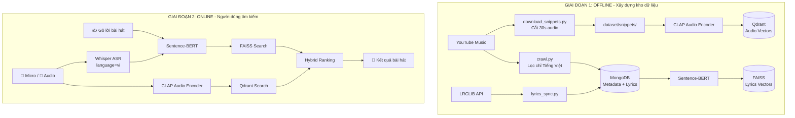

# 🎧 AI Music Matcher / LyricsSearch

> **Hệ thống nhận diện và tìm kiếm bài hát Tiếng Việt thông minh qua giọng hát, đoạn thu âm (Audio Snippet) và lời bài hát (Lyrics).**

Dự án ứng dụng mô hình học sâu kết hợp **Dual-Modality**: **Audio Encoder (CLAP)** + **Text Encoder (SBERT)** kết hợp **Vector Search** (FAISS + Qdrant).

---

## 🌟 Tính năng chính

1. 🎤 **Nhận diện qua Micro**: Người dùng hát trực tiếp trên giao diện web, mô hình **Whisper** bóc tách văn bản tiếng Việt và tìm bài hát tương ứng.
2. 📁 **Tải lên tệp âm thanh**: Tải lên đoạn audio (WAV, MP3) dài ~30s để hệ thống nhận diện bài hát tự động qua **2 nhánh song song** (Audio + Lời).
3. ✍️ **Tìm kiếm qua lời nhạc**: Gõ một hoặc vài câu hát nhớ mang máng, hệ thống sử dụng **Sentence-BERT** và **FAISS** để tìm kiếm ngữ nghĩa.
4. 🎶 **Hybrid Search**: Kết hợp đồng thời **CLAP Audio Embedding** (Qdrant) và **SBERT Text Embedding** (FAISS) để đạt kết quả chính xác nhất.

---

## 🏗️ Kiến trúc & Công nghệ



- **Audio Speech-to-Text**: `openai/whisper-small` (language=vi, GPU qua CUDA FP16).
- **Audio Embedding**: `laion/larger_clap_music_and_speech` (512 chiều, Cosine Similarity).
- **Text Embedding**: `sentence-transformers/paraphrase-multilingual-MiniLM-L12-v2` (384 chiều, Cosine).
- **Audio Vector Search**: `Qdrant` (Cosine Distance, Docker container).
- **Lyrics Vector Search**: `FAISS` (IndexFlatIP, Sliding Window 1-3 câu).
- **Cơ sở dữ liệu**: `MongoDB` lưu trữ metadata, lời đầy đủ, lời đồng bộ (.lrc).
- **Audio Processing**: `librosa`, `soundfile`, `ffmpeg`, `yt-dlp`.
- **Giao diện**: `Streamlit` + `audio-recorder-streamlit`.

---

## 🚀 Hướng dẫn cài đặt & Khởi chạy

### 1. Khởi chạy MongoDB (Docker)
```bash
docker run -d --name lyrics_mongo -p 27017:27017 -v mongo_lyrics_data:/data/db --restart unless-stopped mongo:7.0
```

### 2. Khởi chạy Qdrant (Docker)
```bash
docker run -d --name lyrics_qdrant -p 6333:6333 -p 6334:6334 -v qdrant_data:/qdrant/storage --restart unless-stopped qdrant/qdrant:latest
```

### 3. Tự động nạp nhạc mới bằng AI Data Agent (Khuyên dùng)
Thay vì làm thủ công từng bước, bạn có thể để **AI Data Agent** tự động quét BXH YouTube Music Việt Nam, lọc tiếng Việt, tải lyrics, tải audio snippet và cập nhật vector database:
```bash
# Tự động tìm và nạp 10 bài nhạc Việt mới nhất:
./venv/bin/python pipeline/data_agent.py --limit 10

# Chạy thử nghiệm xem trước danh sách bài hát mới:
./venv/bin/python pipeline/data_agent.py --limit 5 --dry-run
```

### 3b. Chạy trên máy đã có sẵn MongoDB đầy đủ
`lyrics_db.index` / `id_mapping.json` trong repo không khớp với kho nhạc trên máy (index đầy đủ vượt giới hạn 100MB của GitHub), nên sau khi clone cần build lại từ MongoDB:
```bash
python build_index_from_mongo.py         # Lyrics → FAISS (lyrics_db.index + id_mapping.json)
python pipeline/build_audio_index.py     # Audio → CLAP → Qdrant
```
Cần sao lưu kho nhạc ra JSON: `python pipeline/export_mongo.py` (MongoDB → `dataset/dataset_processed.json`).

### 4. Khởi chạy ứng dụng Web (Streamlit)
```bash
./run_web.sh
```
Truy cập trình duyệt tại: `http://localhost:8501`

### 4b. Giao diện web mới (SPA tông xanh – đen)
```bash
./run_webapp.sh   # hoặc: python -m uvicorn webapp.server:app --port 8000
```
Truy cập trình duyệt tại: `http://localhost:8000`

### 5. Chạy demo qua dòng lệnh (CLI)
```bash
./venv/bin/python demo.py
```

---

## 📁 Cấu trúc thư mục

```
LyricsSearch/
├── config.py                  # Cấu hình tập trung (MongoDB, Qdrant, Models)
├── demoweb.py                 # Giao diện Web Streamlit chính
├── audio_encoder.py           # CLAP Audio Encoder + Qdrant Search
├── hybrid_engine.py           # Hybrid Fusion (CLAP + SBERT)
├── ui_components.py           # UI components tái sử dụng
├── audio_analysis.py          # Phân tích tín hiệu âm thanh
├── audio_preprocess.py        # Tiền xử lý audio (khử nhiễu, chuẩn hóa)
├── evaluation.py              # Đánh giá WER/CER (chỉ Tiếng Việt)
├── build_index_from_mongo.py  # SBERT → FAISS Lyrics Index
├── run_detailed_benchmark.py  # Benchmark thực nghiệm
├── demo.py                    # CLI Demo tìm kiếm lời bài hát
├── pipeline/
│   ├── data_agent.py          # 🤖 AI DATA AGENT (Auto Ingestion A-Z)
│   ├── crawl.py               # Cào playlist YouTube (lọc Tiếng Việt)
│   ├── lyrics_sync.py         # Đồng bộ lời từ LRCLIB
│   ├── download_snippets.py   # Tải & cắt 30s audio
│   ├── whisper_transcribe.py  # Whisper ASR (language=vi)
│   ├── build_audio_index.py   # CLAP → Qdrant Audio Index
│   ├── import_mongo.py        # Nạp backup JSON → MongoDB
│   └── export_song_list.py    # Xuất danh sách bài hát
├── lyrics_db.index            # FAISS vector database (lyrics)
├── id_mapping.json            # Mapping FAISS index ↔ MongoDB ID
├── requirements.txt           # Thư viện cần thiết
├── run_web.sh                 # Script khởi chạy web
└── dataset/
    ├── dataset_processed.json # Backup dữ liệu đầy đủ
    └── snippets/              # Các đoạn âm thanh 30s (.wav)
```

---

## 🔄 Thứ tự chạy Pipeline (Offline)

### Cách 1: Tự động hoàn toàn qua AI Data Agent (Khuyên dùng)
```bash
python pipeline/data_agent.py --limit 20
```

### Cách 2: Chạy thủ công từng bước
```
1. python pipeline/crawl.py              — Crawl playlist (chỉ lọc Tiếng Việt)
2. python pipeline/lyrics_sync.py        — Đồng bộ lời từ LRCLIB
3. python pipeline/download_snippets.py  — Tải & cắt 30s audio
4. python pipeline/whisper_transcribe.py — Whisper ASR (language=vi)
5. python build_index_from_mongo.py      — Nhúng lyrics → FAISS
6. python pipeline/build_audio_index.py  — Nhúng audio → CLAP → Qdrant
7. ./run_web.sh                          — Khởi chạy web
```
